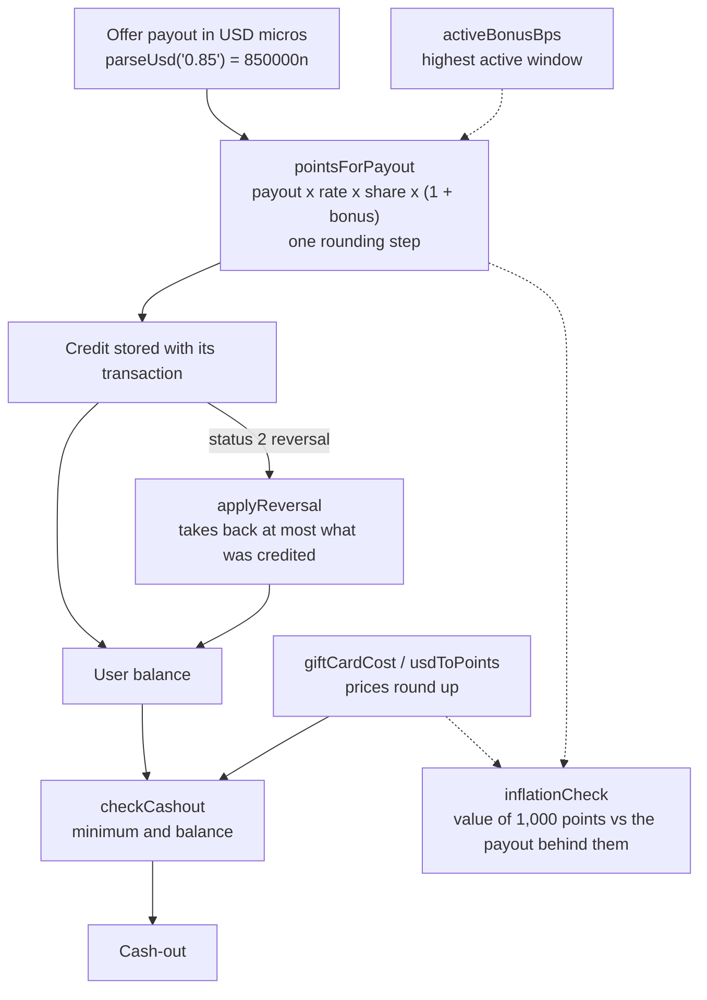

# reward-economy-kit

**Exact, integer-only math for a points currency: payout to points, rounding, bonuses, reversals, cash-out pricing and an inflation check. Same behavior in JavaScript and PHP.**

[](https://moonetix.github.io/reward-economy-kit/)
[](https://github.com/moonetix/reward-economy-kit/actions/workflows/ci.yml)
[](LICENSE)
[](https://docs.moonetix.com/rewards)
[](package.json)
[](https://moonetix.com/tools/virtual-currency-calculator)
[](https://moonetix.com/academy/monetization/virtual-currency-exchange-rate)

Maintained by [Moonetix](https://moonetix.com).

Rewards apps, offerwalls and game economies all turn a dollar payout into points, and most of them do it with floating point. That works until a reversal takes back a slightly different number than was credited, or a bonus and a gift card discount quietly push payouts above revenue. This kit keeps money in integer micro-dollars, points in integer units, and rounds exactly once. The [live calculator](https://moonetix.github.io/reward-economy-kit/) runs it in your browser: enter a payout, a rate, a share and a bonus to see the points credited, what a reversal takes back and the cash-out price.

- **JavaScript:** ESM, BigInt, zero dependencies, TypeScript declarations.
- **PHP:** 8.1+, zero dependencies (no bcmath or gmp needed).
- **One spec:** both suites run the same [test vectors](test-vectors/vectors.json).

## Quick start

The package is not on npm or Packagist yet; install it from Git.

**JavaScript** (`npm install github:moonetix/reward-economy-kit`)

```js
import { defineCurrency, parseUsd, pointsForPayout, applyReversal, inflationCheck, formatUnits } from 'reward-economy-kit';

const coins = defineCurrency({ rate: '1000', userShareBps: 6000 });   // 1000 coins per $1, 60% to users

const credited = pointsForPayout(parseUsd('0.85'), coins, { bonusBps: 1000 }); // 561n = 0.85 x 1000 x 60% x 110%
formatUnits(credited, coins.decimals);                                       // "561"

applyReversal({ balance: 400n, credited });
// { reversed: 561n, newBalance: -161n, uncollected: 0n }

inflationCheck(coins, { bonusBps: 1000 }).effectiveUserShareBps;            // 6600n
```

**PHP**

```bash
composer config repositories.rek vcs https://github.com/moonetix/reward-economy-kit
composer require moonetix/reward-economy-kit:^1.0
```

```php
use Moonetix\RewardEconomy\RewardEconomy as Rewards;

$coins = Rewards::defineCurrency(['rate' => '1000', 'userShareBps' => 6000]);

$credited = Rewards::pointsForPayout(Rewards::parseUsd('0.85'), $coins, bonusBps: 1000); // 561
Rewards::applyReversal(balance: 400, credited: $credited);
// ['reversed' => 561, 'newBalance' => -161, 'uncollected' => 0]
```

Amounts are `bigint` in JavaScript (safe integer numbers are accepted as input) and `int` in PHP. Results are limited to `2^63 - 1` in both, and anything larger throws instead of wrapping. In PHP, options are named arguments (`bonusBps: 1000`) instead of an options object.

## What it covers



| Function | What it does |
| --- | --- |
| `defineCurrency(config)` | Validates rate, user share (basis points), decimals, rounding and redemption rate |
| `pointsForPayout(payout, currency, { bonusBps })` | Payout to points, one rounding step |
| `divRound(n, d, mode)` | `floor` (default), `ceil`, `half-up`, `half-even` |
| `activeBonusBps(windows, at)` | Bonus for one-off, daily and weekly windows; the highest active window wins |
| `reversalAmount({ credited, alreadyReversed }, requested)` | What a reversal may take back; never more than was credited. Omit `requested` for a full reversal |
| `applyReversal({ balance, credited, alreadyReversed, requested, allowNegativeBalance })` | Applies it, with or without a floor at zero |
| `pointsToUsd`, `usdToPoints` | Face value of points, and the points price of a dollar amount |
| `giftCardCost(face, currency, { feeBps, feeMicros })` | Points price of a card, optionally passing the provider fee on |
| `checkCashout({ balance, cost, minimum })` | Minimum and balance check with the shortfall |
| `inflationCheck(currency, { bonusBps, giftCard })` | Value of 1,000 points, the payout behind them, the effective share |
| `moonetixCurrency`, `moonetixBonusBps` | Preset that matches the [Moonetix rewards docs](https://docs.moonetix.com/rewards) |
| `parseUsd`, `formatUsd`, `parseUnits`, `formatUnits` | Exact conversion between decimal strings and integers |

The design guide, with worked examples for choosing a rate and a user share, is in [docs/guide.md](docs/guide.md).

## Currency options

`defineCurrency` validates once and returns a frozen object. Every function also accepts the plain config and validates it on the fly.

| Option | Default | Range | Meaning |
| --- | --- | --- | --- |
| `rate` | required | > 0, up to 6 decimals | Points per 1 USD of payout, before the user share. Pass a string (`'1250.75'`) for fractions |
| `userShareBps` | required | 1 to 10000 | Share of the payout given to users, in basis points (`6000` = 60%) |
| `decimals` | `0` | 0 to 6 | Decimals of the currency. `0` means whole points |
| `rounding` | `'floor'` | `floor`, `ceil`, `half-up`, `half-even` | How earned points are rounded |
| `redemptionRate` | `rate` | > 0, up to 6 decimals | Points per 1 USD at cash-out. Set it higher than `rate` to price rewards above their face value |

Per-call options: `bonusBps` (0 to 1,000,000, so up to +10,000%), `feeBps` and `feeMicros` on `giftCardCost`, `minimum` on `checkCashout` (default 0), `rounding` on `pointsToUsd` (default `floor`) and `usdToPoints` (default `ceil`). Bonus windows are `{ bonusBps, start, end, repeat }` with Unix seconds, `[start, end)`, `null` for an open end and `repeat` of `none` (default), `daily` or `weekly`.

## How it works

1. A payout is held as integer micro-dollars. `parseUsd('0.333')` is `333000n`; floats are rejected.
2. The rate is stored in micro-units too, so `'0.5'` or `'1250.75'` stay exact.
3. `pointsForPayout` multiplies payout, rate, share and bonus as one exact integer product and divides once by a power of ten. Only that last step rounds.
4. The PHP port does the same product with a small decimal-string integer class, because the product exceeds 64 bits long before the result does.
5. A reversal is measured against the stored credit and what was already reversed, never recomputed.
6. Prices (`usdToPoints`, `giftCardCost`) round up; values (`pointsToUsd`) round down. Neither can sell value below cost.
7. `inflationCheck` compares the redemption value of 1,000 points with the payout that created them, using exact rational comparison for the `exceedsRevenue` flag.

## Choices worth knowing

- **Floor by default.** It never pays users more than their share, and tiny steps cannot be farmed for a rounding gain. The cost is under one unit per credit; pick a rate that makes that negligible. See [Rounding](docs/guide.md#rounding).
- **Bonuses do not stack.** When several windows overlap, the highest applies.
- **Repeats are fixed periods.** Daily and weekly windows repeat every 86,400 and 604,800 seconds from `start`. For wall-clock repeats across daylight saving changes, expand the windows with your time zone library.
- **Negative balances are allowed by default** after a reversal, which keeps the books exact. Pass `allowNegativeBalance: false` to stop at zero and get the remainder as `uncollected`.

## Common errors

Errors are thrown, never returned. JavaScript throws `TypeError` for a wrong type and `RangeError` for a bad value; PHP throws `InvalidArgumentException` with the same text for bad values, and its own `TypeError` for wrong argument types.

| Message | Cause and fix |
| --- | --- |
| `payoutMicros must be a bigint or a safe integer, got 0.85` | A dollar float was passed. Convert first: `parseUsd('0.85')` |
| `usd must be a string` | `parseUsd(0.85)`. Pass the payout as a string, exactly as your network or database delivers it |
| `usd has more than 6 decimals` | The amount is finer than a micro-dollar. Round it at the source, on purpose |
| `rate must be a plain decimal like 12 or 0.375, got "1,000"` | Thousands separators, signs or exponents in a decimal string |
| `alreadyReversed is larger than credited` | Your reversal ledger is out of sync with the credit. Fix the data; the kit will not guess |
| `bonus window 0: a daily window must be shorter than its period` | A repeating window of 24 hours or more. Use a one-off window (`repeat: 'none'`) instead |
| `points exceeds MAX_AMOUNT` | The result is above `2^63 - 1`. Usually `decimals` or `rate` is far larger than intended |

Watch `userShareBps`: it is basis points, so `60` is 0.6%, not 60%. And in your own JavaScript, mixing results with plain numbers (`credited + 1`) throws `Cannot mix BigInt and other types`; use `1n`.

## Moonetix preset

`moonetixCurrency({ rate, splitPercent, rounding: 'whole' | 'three-decimals' })` follows the formula on [docs.moonetix.com/rewards](https://docs.moonetix.com/rewards): `payout x conversion rate x split / 100 x (1 + bonus / 100)`, rounded to whole numbers or 3 decimals, halves up. The test vectors reproduce every example on that page: 250, 275, 17, 0.375, 0.008 and 3.

Postbacks from Moonetix already carry the reward in your currency. Credit `{reward}` as received and use the preset for previews, tests and offer lists built from the [Offers API](https://docs.moonetix.com/offers-api). To try settings without code, use the [Virtual Currency Calculator](https://moonetix.com/tools/virtual-currency-calculator).

## Tests

```bash
npm test                 # node --test: shared vectors + API tests
php php/tests/run.php    # shared vectors + PHP-specific checks
```

`test-vectors/vectors.json` holds 164 cases across every function, including exact-half rounding in all four modes, results at and beyond the 64-bit limit, bonus window edges, partial reversals and the Moonetix docs examples. A change that breaks parity between the two implementations fails one of the suites.

## Further reading

- [Designing a rewards currency](docs/guide.md), the guide in this repository
- Moonetix docs: [Rewards and currency](https://docs.moonetix.com/rewards), [Credits and reversals](https://docs.moonetix.com/credits-and-reversals), [Postbacks](https://docs.moonetix.com/postbacks)
- Moonetix Academy: [Virtual currency exchange rate](https://moonetix.com/academy/monetization/virtual-currency-exchange-rate), [Virtual economy design](https://moonetix.com/academy/monetization/virtual-economy-design), [Reward hold periods](https://moonetix.com/academy/monetization/reward-hold-periods)
- Calculators: [Virtual Currency](https://moonetix.com/tools/virtual-currency-calculator), [Rewards Site Profit](https://moonetix.com/tools/rewards-site-profit-calculator), [Offerwall Earnings](https://moonetix.com/tools/offerwall-earnings-calculator)
- For rewards sites: [moonetix.com/industries/rewards-sites](https://moonetix.com/industries/rewards-sites)

## About Moonetix

Moonetix is an affiliate network. Publishers add its offerwall to an app, game, website, bot or community, and users earn the publisher's own currency by completing offers. Publisher accounts: [moonetix.com/register](https://moonetix.com/register?from=github-reward-economy-kit).

Other open source from Moonetix: [referral-engine](https://github.com/moonetix/referral-engine) for referral commissions with clawbacks, [gamification-kit](https://github.com/moonetix/gamification-kit) for streaks and quests, [postback-tester](https://github.com/moonetix/postback-tester) to test the postback handler that credits these points, and [signup-guard](https://github.com/moonetix/signup-guard), [offerwall-fraud-playbook](https://github.com/moonetix/offerwall-fraud-playbook), [country-tiers](https://github.com/moonetix/country-tiers), [rewards-site-starter](https://github.com/moonetix/rewards-site-starter). Integration examples for web, mobile, games and communities are listed in [awesome-offerwalls](https://github.com/moonetix/awesome-offerwalls).

## License

MIT. See [LICENSE](LICENSE).
