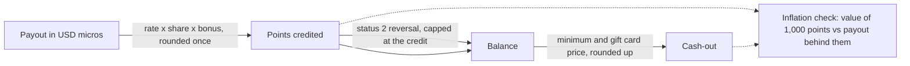

# reward-economy-kit

**Exact, integer-only math for a points currency: payout to points, rounding, bonuses, reversals, cash-out pricing and an inflation check. Same behavior in JavaScript and PHP.**

[](https://github.com/moonetix/reward-economy-kit/actions/workflows/ci.yml)
[](LICENSE)
[](https://docs.moonetix.com/rewards)
[](package.json)
[](https://moonetix.com/tools/virtual-currency-calculator)
[](https://moonetix.com/academy/monetization/virtual-currency-exchange-rate)

Maintained by [Moonetix](https://moonetix.com).

Rewards apps, offerwalls and game economies all turn a dollar payout into points, and most of them do it with floating point. That works until a reversal takes back a slightly different number than was credited, or a bonus and a gift card discount quietly push payouts above revenue. This kit keeps money in integer micro-dollars, points in integer units, and rounds exactly once.

- **JavaScript:** ESM, BigInt, zero dependencies, TypeScript declarations.
- **PHP:** 8.1+, zero dependencies (no bcmath or gmp needed).
- **One spec:** both suites run the same [test vectors](test-vectors/vectors.json).

The design guide, with worked examples for choosing a rate and a user share, is in [docs/guide.md](docs/guide.md).

## What it covers



| Function | What it does |
| --- | --- |
| `defineCurrency(config)` | Validates rate, user share (basis points), decimals, rounding and redemption rate |
| `pointsForPayout(payout, currency, { bonusBps })` | Payout to points, one rounding step |
| `divRound(n, d, mode)` | `floor` (default), `ceil`, `half-up`, `half-even` |
| `activeBonusBps(windows, at)` | Bonus for one-off, daily and weekly windows; the highest active window wins |
| `reversalAmount(credit, requested)` | What a reversal may take back; never more than was credited |
| `applyReversal({ balance, credited, ... })` | Applies it, with or without a floor at zero |
| `pointsToUsd`, `usdToPoints` | Face value of points, and the points price of a dollar amount |
| `giftCardCost(face, currency, { feeBps, feeMicros })` | Points price of a card, optionally passing the provider fee on |
| `checkCashout({ balance, cost, minimum })` | Minimum and balance check with the shortfall |
| `inflationCheck(currency, { bonusBps, giftCard })` | Value of 1,000 points, the payout behind them, the effective share |
| `moonetixCurrency`, `moonetixBonusBps` | Preset that matches the [Moonetix rewards docs](https://docs.moonetix.com/rewards) |
| `parseUsd`, `formatUsd`, `parseUnits`, `formatUnits` | Exact conversion between decimal strings and integers |

## Quick start

The package is not on npm or Packagist yet. Copy it in or install from Git:

```bash
npm install github:moonetix/reward-economy-kit
composer config repositories.rek vcs https://github.com/moonetix/reward-economy-kit
composer require moonetix/reward-economy-kit:^1.0
```

**JavaScript**

```js
import { defineCurrency, parseUsd, pointsForPayout, applyReversal, inflationCheck, formatUnits } from 'reward-economy-kit';

const coins = defineCurrency({ rate: '1000', userShareBps: 6000 });   // 1000 coins per $1, 60% to users

const credited = pointsForPayout(parseUsd('0.85'), coins, { bonusBps: 1000 }); // 561n (561.0, 10% bonus)
formatUnits(credited, coins.decimals);                                       // "561"

applyReversal({ balance: 400n, credited });
// { reversed: 561n, newBalance: -161n, uncollected: 0n }

inflationCheck(coins, { bonusBps: 1000 }).effectiveUserShareBps;            // 6600n
```

**PHP**

```php
use Moonetix\RewardEconomy\RewardEconomy as Rewards;

$coins = Rewards::defineCurrency(['rate' => '1000', 'userShareBps' => 6000]);

$credited = Rewards::pointsForPayout(Rewards::parseUsd('0.85'), $coins, bonusBps: 1000); // 561
Rewards::applyReversal(balance: 400, credited: $credited);
// ['reversed' => 561, 'newBalance' => -161, 'uncollected' => 0]
```

Amounts are `bigint` in JavaScript (safe integer numbers are accepted as input) and `int` in PHP. Results are limited to `2^63 - 1` in both, and anything larger throws instead of wrapping.

## How it works

1. A payout is held as integer micro-dollars. `parseUsd('0.333')` is `333000n`; floats are rejected.
2. The rate is stored in micro-units too, so `'0.5'` or `'1250.75'` stay exact.
3. `pointsForPayout` multiplies payout, rate, share and bonus as one exact integer product and divides once by a power of ten. Only that last step rounds.
4. The PHP port does the same product with a small decimal-string integer class, because the product exceeds 64 bits long before the result does.
5. A reversal is measured against the stored credit and what was already reversed, never recomputed.
6. Prices (`usdToPoints`, `giftCardCost`) round up; values (`pointsToUsd`) round down. Neither can sell value below cost.
7. `inflationCheck` compares the redemption value of 1,000 points with the payout that created them, using exact rational comparison for the `exceedsRevenue` flag.

## Choices worth knowing

- **Floor by default.** It never pays users more than their share, and tiny steps cannot be farmed for a rounding gain. The cost is under one unit per credit; pick a rate that makes that negligible. See [Rounding](docs/guide.md#rounding).
- **Bonuses do not stack.** When several windows overlap, the highest applies.
- **Repeats are fixed periods.** Daily and weekly windows repeat every 86,400 and 604,800 seconds from `start`. For wall-clock repeats across daylight saving changes, expand the windows with your time zone library.
- **Negative balances are allowed by default** after a reversal, which keeps the books exact. Pass `allowNegativeBalance: false` to stop at zero and get the remainder as `uncollected`.

## Moonetix preset

`moonetixCurrency({ rate, splitPercent, rounding: 'whole' | 'three-decimals' })` follows the formula on [docs.moonetix.com/rewards](https://docs.moonetix.com/rewards): `payout x conversion rate x split / 100 x (1 + bonus / 100)`, rounded to whole numbers or 3 decimals, halves up. The test vectors reproduce every example on that page: 250, 275, 17, 0.375, 0.008 and 3.

Postbacks from Moonetix already carry the reward in your currency. Credit `{reward}` as received and use the preset for previews, tests and offer lists built from the [Offers API](https://docs.moonetix.com/offers-api). To try settings without code, use the [Virtual Currency Calculator](https://moonetix.com/tools/virtual-currency-calculator).

## Tests

```bash
npm test                 # node --test: shared vectors + API tests
php php/tests/run.php    # shared vectors + PHP-specific checks
```

`test-vectors/vectors.json` holds 164 cases across every function, including exact-half rounding in all four modes, results at and beyond the 64-bit limit, bonus window edges, partial reversals and the Moonetix docs examples. A change that breaks parity between the two implementations fails one of the suites.

## Further reading

- [Designing a rewards currency](docs/guide.md), the guide in this repository
- Moonetix docs: [Rewards and currency](https://docs.moonetix.com/rewards), [Credits and reversals](https://docs.moonetix.com/credits-and-reversals), [Postbacks](https://docs.moonetix.com/postbacks)
- Moonetix Academy: [Virtual currency exchange rate](https://moonetix.com/academy/monetization/virtual-currency-exchange-rate), [Virtual economy design](https://moonetix.com/academy/monetization/virtual-economy-design), [Reward hold periods](https://moonetix.com/academy/monetization/reward-hold-periods)
- Calculators: [Virtual Currency](https://moonetix.com/tools/virtual-currency-calculator), [Rewards Site Profit](https://moonetix.com/tools/rewards-site-profit-calculator), [Offerwall Earnings](https://moonetix.com/tools/offerwall-earnings-calculator)
- For rewards sites: [moonetix.com/industries/rewards-sites](https://moonetix.com/industries/rewards-sites)

## About Moonetix

Moonetix is a pay-per-result affiliate network. Publishers add its offerwall to an app, game, website, bot or community, and users earn the publisher's own currency by completing offers. Publisher accounts: [moonetix.com/register](https://moonetix.com/register).

Other open source from Moonetix: [awesome-offerwalls](https://github.com/moonetix/awesome-offerwalls), [awesome-app-monetization](https://github.com/moonetix/awesome-app-monetization), [offerwall-postback-handlers](https://github.com/moonetix/offerwall-postback-handlers), [offerwall-nextjs-starter](https://github.com/moonetix/offerwall-nextjs-starter), [telegram-mini-app-offerwall](https://github.com/moonetix/telegram-mini-app-offerwall), [discord-rewards-bot](https://github.com/moonetix/discord-rewards-bot), [moonetix-offerwall-wordpress](https://github.com/moonetix/moonetix-offerwall-wordpress), [rewards-site-starter](https://github.com/moonetix/rewards-site-starter), [offerwall-laravel](https://github.com/moonetix/offerwall-laravel), [offerwall-express](https://github.com/moonetix/offerwall-express), [moonetix-android-sdk](https://github.com/moonetix/moonetix-android-sdk), [moonetix-ios-sdk](https://github.com/moonetix/moonetix-ios-sdk), [moonetix-flutter](https://github.com/moonetix/moonetix-flutter), [moonetix-react-native](https://github.com/moonetix/moonetix-react-native), [moonetix-unity](https://github.com/moonetix/moonetix-unity).

## License

MIT. See [LICENSE](LICENSE).
